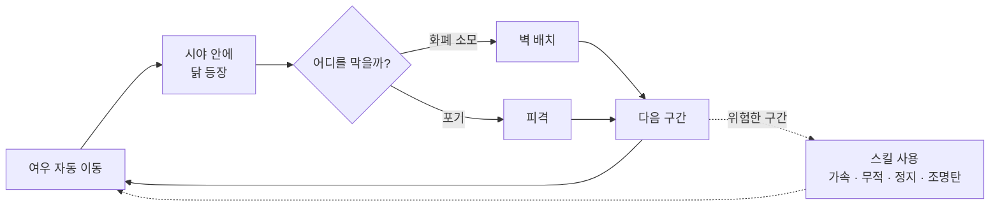
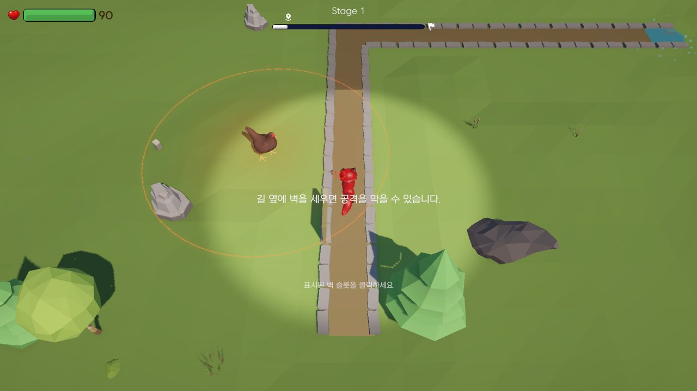
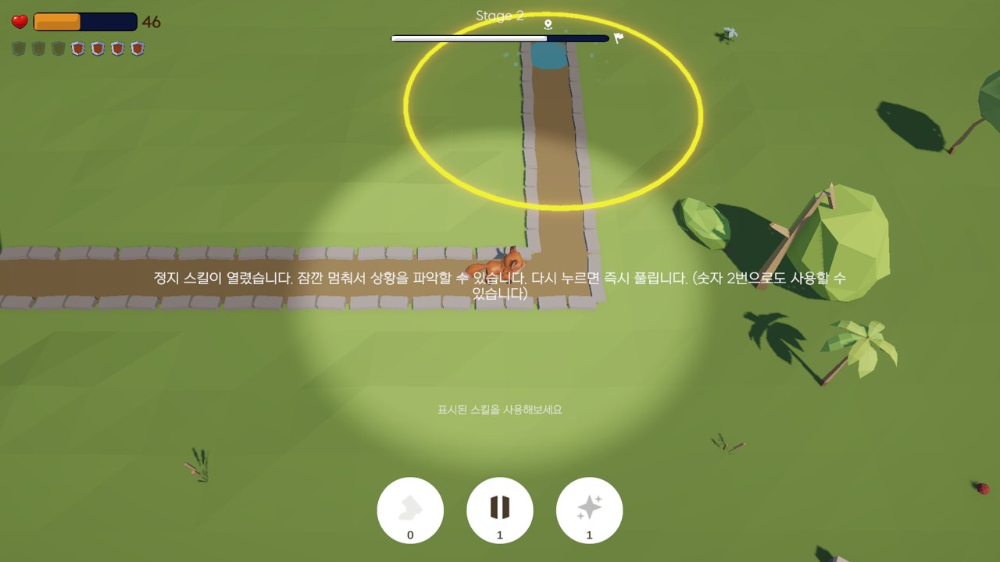
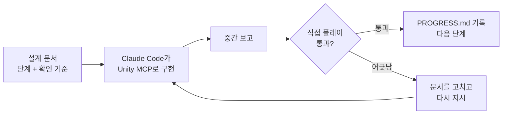

<div align="center">

# 여우는 죄가 없다

타워를 세우는 쪽이 아니라, 타워 사이를 지나가야 하는 쪽이 되는 리버스 타워디펜스


<br/>


<!-- 플레이 영상이 생기면 아래 주석을 풀고 링크를 넣으세요
[](https://youtu.be/영상주소)
-->

</div>

<br/>

## 프로젝트 개요

| 항목 | 내용 |
| --- | --- |
| 장르 | 리버스 타워디펜스 (탑다운) |
| 엔진 | Unity 6.3 (URP), Cinemachine, Coplay Unity MCP |
| 기간 | 2026.09 (약 2주) |
| 인원 | 1인 (기획) + Claude Code |
| 결과물 | 튜토리얼 2개를 포함한 5스테이지 플레이 버전, 플레이테스트 9명 · 플레이 로그 264판 |
| 계기 | 디벨로켓 게임기획 38기 「게임엔진 응용 프로그래밍」 과제를 개인 프로젝트로 확장 |

저는 기획자이고, 이 프로젝트에서 코드는 직접 쓰지 않았습니다.
설계 문서를 쓰고 Claude Code가 Unity MCP로 에디터를 조작해 구현하면, 단계마다 직접 플레이해 보고 통과 여부를 정했습니다.
AI와 함께 기획부터 플레이테스트까지 혼자 끝낸 첫 프로젝트입니다.

<br/>

## 기획 의도

타워디펜스에서 플레이어는 늘 막는 쪽입니다. 이 자리를 바꿔 보고 싶었습니다.

여우는 정해진 길을 따라 혼자 걸어갑니다. 길가에 자리 잡은 닭들은 지나가는 여우에게 달걀을 던집니다.
플레이어가 할 수 있는 일은 정해진 화폐 안에서 벽을 세워 달걀을 막는 것 하나입니다.

화폐는 일부러 모자라게 줍니다. 모든 공격을 막을 수는 없으니, 어느 공격을 맞고 지나갈지 플레이어가 골라야 합니다.
이 선택이 게임의 중심입니다.

수업에서 배운 메커닉(이동, 자동 공격, 타겟 감지, 체력, 피격 피드백)은 스크립트를 가져다 쓰지 않았습니다.
기능의 개념만 남기고, 공격하던 쪽과 맞던 쪽을 뒤집어 빈 프로젝트에서 새로 설계했습니다.

<br/>

## 게임 규칙

- 길은 타일 단위로 나뉘고, 타일마다 좌우에 벽 슬롯이 하나씩 있습니다. 슬롯을 클릭하면 벽이 세워집니다.
- 벽은 한 종류, 한 칸만 막고, 세운 뒤에는 부서지지 않습니다. 여우의 이동에는 영향을 주지 않고 달걀만 막습니다.
- 벽은 여우가 아직 지나가지 않은 타일에만 세울 수 있습니다. 미리 배치하는 단계 없이 걸어가는 동안 실시간으로 세웁니다.
- 화폐는 스테이지 시작 때 한 번에 전부 받고, 시간이 지나도 늘지 않습니다. 화면 왼쪽 위의 방패 아이콘 하나가 벽 하나이고, 세울 때마다 회색으로 바뀝니다.
- 여우 주변의 원형 시야 안에 들어온 닭과 공격 범위만 보입니다. 한 번 드러난 닭은 계속 보입니다.
- 도착 지점에 체력이 남은 채로 도착하면 클리어입니다. 다시 도전하면 화폐 · 닭 배치 · 길이 똑같이 리셋돼서, 죽으면서 외우는 재미가 생기도록 했습니다.



<br/>

## 플레이 화면

| 스테이지 1 튜토리얼 | 스테이지 2 스킬 튜토리얼 |
| :---: | :---: |
|  |  |
| 달걀을 한 대 맞은 뒤에 벽 슬롯 안내가 뜹니다 | 새 스킬이 열리면 멈추고 설명합니다. 왼쪽 위 방패는 남은 벽 |
| **스테이지 3** | **스테이지 2** |
|  |  |
| 시야 안에 들어온 닭과 공격 범위만 보입니다 | 닭 바로 옆을 지나는 구간 |

<br/>

## 주요 시스템

### 닭 3종

| 타입 | 사거리 | 쿨다운 / 공격력 | 설계한 역할 |
| --- | --- | --- | --- |
| 기본형 | 보통 | 보통 / 보통 | 기준점. 튜토리얼에서 벽 배치를 익히는 용도 |
| 광역 사거리형 | 넓음 | 보통 / 낮음 | 많은 칸을 얕게 위협합니다. 전부 막으려 하면 화폐가 바닥납니다 |
| 고DPS형 | 좁음 | 짧음 / 높음 | 위협하는 칸은 적지만 안 막으면 금방 위험해집니다. 먼저 막아야 할 대상 |

세 종류는 같은 스크립트에 수치만 다르게 넣은 프리팹입니다. 종류를 늘릴 때 코드를 건드리지 않고 값만 조정할 수 있게 했습니다.

### 스킬과 함정

여우는 사용 횟수가 정해진 스킬 4가지(순간 가속, 무적, 정지, 조명탄)를 씁니다. 조명탄은 잠깐 시야를 넓혀 줍니다.
스킬은 처음부터 다 주지 않고 스테이지 2에서 하나씩 열립니다. 새 스킬이 열리면 게임이 멈추고 쓰는 법을 알려 줍니다. 화면 아래 버튼을 누르거나 숫자키로 쓸 수 있습니다.
함정 2가지(주기적으로 떨어지는 낙석, 항상 켜져 있는 가시함정)는 벽으로 막을 수 없어서 스킬로 넘겨야 합니다.

### 스테이지 제작 방식

매니저와 HUD만 들어 있는 템플릿 씬을 만들어 두고, 제가 길과 닭을 배치하면 나머지 세팅은 Claude Code가 정해진 절차([`docs/stage-add-guide.md`](docs/stage-add-guide.md))대로 채웠습니다.
이 방식으로 스테이지 3 ~ 5를 만들었습니다.

<br/>

## 밸런스 설계

화폐는 감으로 정하지 않고 아래 공식에서 출발했습니다.

```
화폐(B) = N_필수 + α × N_선택
```

| 변수 | 의미 |
| --- | --- |
| `N_필수` | 고DPS형이 위협하는 타일 수. 사실상 꼭 막아야 하는 칸 |
| `N_선택` | 광역 사거리형이 위협하는 타일 수. 일부만 막아도 살 수 있는 칸 |
| `α` | 0.4 ~ 0.7. 선택 칸 중 막을 수 있는 비율. 뒤 스테이지일수록 낮춥니다 |

피해 없이 클리어할 수 없도록 일부러 설계했습니다. 얼마나 적게 맞고 통과했는지가 자연스럽게 점수가 됩니다.

시야는 `반응 시간 = 시야 반경 ÷ 이동 속도`로 잡았습니다. 닭이 보인 뒤 벽을 세울 시간이 이 값으로 정해지기 때문에, 난이도를 조절하는 손잡이로 썼습니다.

<br/>

## 설계 의도 검증

처음부터 확인하고 싶은 의도 두 가지를 정하고, 각각 측정할 수 있는 지표로 바꿨습니다.
플레이 로그는 직접 설계한 `PlayStatsLogger`가 자동으로 쌓고, 체감은 설문으로 따로 물었습니다.
2026년 9월 18일에 9명이 플레이했고 로그는 264판이 모였습니다.

| 의도 | 기대한 경험 | 확인 방법 | 결과 |
| --- | --- | --- | --- |
| 화폐 밸런스 | 다 막을 수 없어서 고르게 된다 | 잔여 화폐 0 ~ 1, 잔여 체력 30 ~ 70%. "벽 위치를 고민했나" 설문 | 고민했다 2/9. 너무 빠듯했다는 응답이 6명 |
| 제한된 시야 | 좁은 시야가 순간 판단을 압박한다 | 닭 등장 → 벽 배치까지 1.5 ~ 3초. 타이밍 설문 | 시야가 너무 좁다 7/9, 어려웠다 7/9 |

게임을 이해했다, 재미있었다는 응답은 각각 8/9로 컨셉은 전달됐습니다.
문제는 강도였습니다. 고르게 만들려고 넣은 압박이 너무 세서, 플레이어는 고르기도 전에 살아남기 바빴습니다.
가장 어렵다고 꼽힌 곳은 스테이지 3(4명)이었습니다.

만든 저는 답을 알고 플레이하니 이 부분을 전혀 느끼지 못했습니다. 테스트를 받아 보지 않았다면 모르고 지나갔을 문제입니다.

<br/>

## 기획 판단 기록

<details>
<summary><b>벽은 발사를 취소하지 않고, 날아온 달걀을 막는다</b></summary>
<br/>

처음에는 닭이 쏘기 전에 Raycast로 벽을 확인해서 발사 자체를 취소했습니다.
그러자 화면에서는 닭이 그냥 가만히 있는 것처럼 보였고, 벽으로 막아 냈다는 느낌이 없었습니다.

닭은 항상 던지고 달걀이 벽에 부딪혀 깨지도록 바꿨습니다. 빠른 투사체가 벽을 뚫고 지나가는 문제는 SphereCast로 해결했습니다.
판정 결과는 같아도 플레이어 눈에 보이는 방식이 다르면 다른 게임이 된다는 걸 이때 배웠습니다.
</details>

<details>
<summary><b>튜토리얼은 먼저 겪게 하고 나중에 설명한다</b></summary>
<br/>

벽을 세우는 법부터 글로 알려주지 않았습니다. 스테이지 1에서는 여우가 달걀을 먼저 한 대 맞고,
그다음에 "길 옆에 벽을 세우면 공격을 막을 수 있다"는 안내와 함께 벽 슬롯이 표시됩니다.
"모든 걸 막을 수는 없다"는 규칙도 같은 방식으로, 화폐가 모자라는 상황을 먼저 겪게 한 뒤 짧게 설명을 붙였습니다.
설명 중에는 게임을 멈추고(`timeScale = 0`) 하이라이트와 카메라 줌으로 볼 곳을 짚어 줍니다.
</details>

<details>
<summary><b>에셋 이름은 바꾸지 않고 문서에 대응표를 둔다</b></summary>
<br/>

에셋 이름이 실제 역할과 맞지 않는 경우가 있었습니다. 이름을 바꾸면 `.meta` 참조가 깨질 위험이 있어서,
이름은 그대로 두고 [`CLAUDE.md`](CLAUDE.md) 맨 위에 "이 프리팹이 실제로는 무엇인지" 표를 적어 두었습니다.
깔끔함보다 프로젝트가 망가지지 않는 쪽을 골랐습니다.
</details>

<br/>

## Claude Code와 작업한 방식

### 역할

| 기획 (직접) | 구현 (Claude Code + Unity MCP) |
| --- | --- |
| 컨셉, 설계 의도, 검증 지표 정의 | 설계 문서를 보고 C# 스크립트 작성 |
| 0 ~ 10단계 설계 문서와 단계별 확인 기준 작성 | 씬, 프리팹, 컴포넌트를 에디터에서 직접 구성 |
| 단계마다 직접 플레이하고 통과 여부 판단 | 단계가 끝날 때마다 무엇을 했는지 보고 |
| 화폐 공식과 수치, 플레이테스트 설계와 해석 | 플레이 로그 수집 도구 구현 |
| 넣을 기능과 뺄 기능 결정 | 템플릿 씬 기반 스테이지 세팅 |

### 작업 흐름



### 작업 규칙

초반에 몇 번 시켜 보니, 기준이 애매한 부분은 AI가 알아서 채워 넣었고 결과가 제 의도와 달라졌습니다.
그래서 지켜야 할 규칙을 [`CLAUDE.md`](CLAUDE.md)에 적어 두고 매 세션 처음에 읽게 했습니다.

- 설계에 없는 수치나 규칙이 필요하면 정하지 말고 물어볼 것
- 한 번에 한 단계만 진행하고, 끝나면 보고한 뒤 확인을 받을 것
- 기획 문서가 있는 `docs/`는 수정하지 말 것. 진행 상황은 루트의 `PROGRESS.md`에만 기록
- 씬과 프리팹 파일을 텍스트로 고치지 말 것, 에셋 이름을 바꾸지 말 것

세션이 바뀌어도 이어서 작업할 수 있도록, `PROGRESS.md`에는 완료한 일뿐 아니라 작업 중에 새로 정한 값(타일 크기, 레이어 이름 등)도 남기게 했습니다.

### 레포에 있는 문서

| 문서 | 내용 |
| --- | --- |
| [`CLAUDE.md`](CLAUDE.md) | AI 작업 규칙, 에셋 대응표 |
| [`PROGRESS.md`](PROGRESS.md) | 단계별 진행 상황, 검증 결과, 작업 중 정한 사항 |
| [`docs/design.md`](docs/design.md) | 게임 규칙, 밸런스 공식, 0 ~ 10단계 구현 순서 |
| [`docs/reference.md`](docs/reference.md) | 기능 명세, 일부러 뺀 설계, 과제 요건 |
| [`docs/tutorial.md`](docs/tutorial.md) | 튜토리얼 흐름과 연출 |
| [`docs/feature-expansion.md`](docs/feature-expansion.md) | 스킬, 함정, 특수 지형 추가 기획 |
| [`docs/stage-add-guide.md`](docs/stage-add-guide.md) | 템플릿 씬으로 스테이지를 추가하는 절차 |
| [`docs/ui-design.md`](docs/ui-design.md), [`docs/polish.md`](docs/polish.md) | HUD와 결과 화면 설계, 폴리싱 순서 |

<br/>

## 실행 방법

1. Unity Hub에서 Unity **6000.3.9f1**(6.3 LTS)로 이 폴더를 엽니다.
2. `Assets/Scenes/MainMenu.unity`를 열고 Play를 누릅니다.
3. 스테이지는 `Stage1(Tutorial)` → `Stage2(Tutorial)` → `Stage3` ~ `Stage5` 순서로 이어집니다.

<br/>

## 회고

### 잘된 점

기획 문서가 그대로 개발 지시서가 됐습니다. "재미있게"처럼 쓰면 AI가 제멋대로 해석했고,
"닭이 보이고 1.5 ~ 3초 안에 판단하게"처럼 확인할 수 있는 문장으로 써야 의도대로 나왔습니다. 기획서를 쓰는 습관이 이때 많이 바뀌었습니다.

판단 근거를 데이터로 남겼습니다. 화폐 공식과 측정 지표를 먼저 정하고, 로그를 쌓는 도구를 만든 뒤 실제 테스트로 확인했습니다.

마감 앞에서 범위를 줄였습니다. 스킬과 함정까지만 넣고, 빙결 지대 같은 특수 지형은 나중에 붙일 수 있는 구조만 남겨 두고 보류했습니다.

### 아쉬운 점

설계가 바뀌었는데 문서가 따라오지 못했습니다. 벽 판정을 Raycast에서 물리 충돌로 바꾼 뒤에도 `PROGRESS.md`의 확인 기준은 예전 방식으로 남아 있었습니다.
AI는 문서를 기준으로 일하기 때문에, 설계를 바꾸면 문서부터 고쳐야 했습니다.

원인을 AI 쪽에서 먼저 찾았습니다. 프리팹 구조가 갑자기 초기화됐을 때 MCP 오류부터 의심했는데, 실제로는 제가 모델 파일을 손으로 다시 불러온 탓이었습니다.
AI와 같이 작업할 때는 제가 손으로 한 조작까지 기록해 둬야 원인을 빨리 찾을 수 있었습니다.

재미를 늦게 확인했습니다. 기본 구현을 다 끝내고 나서야 벽만 세우는 플레이가 단조롭다고 느껴 스킬과 함정을 추가했습니다.
다음에는 코어 루프만 있는 단계에서 먼저 플레이해 보고 방향을 정할 생각입니다.

### 다음에 할 것

- 시야 반경과 화폐 압박을 낮추고 같은 지표로 다시 테스트
- 초반 스테이지에 여유를 둬서 난이도 곡선 다시 잡기
- 보류한 빙결 지대 등 특수 지형 추가

<!-- 노션 회고 페이지를 공개했다면 아래 주석을 풀고 링크를 넣으세요
전체 회고: [노션 기획 일지](https://노션주소)
-->

<br/>

<div align="center">
<sub>김진용 · Game Designer</sub>
</div>
