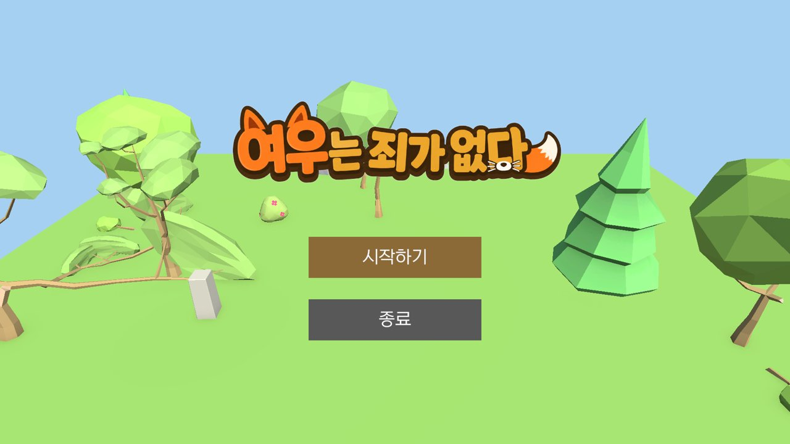
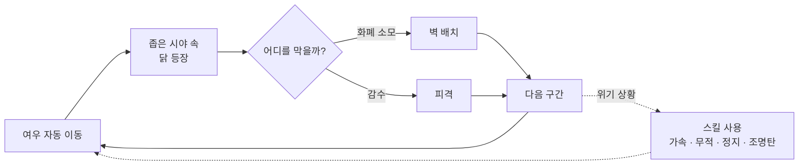
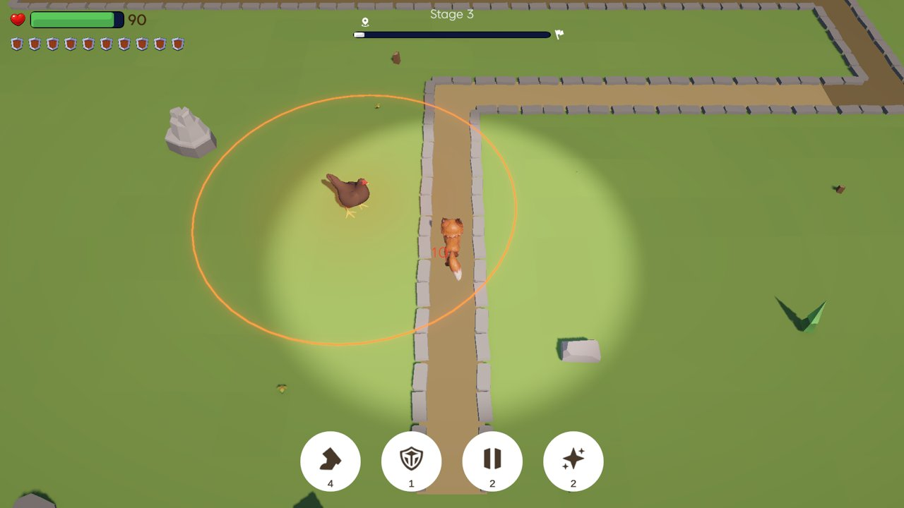
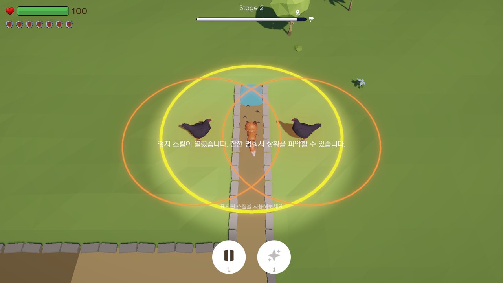
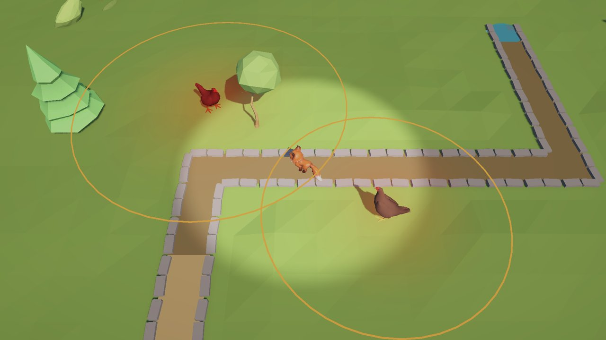
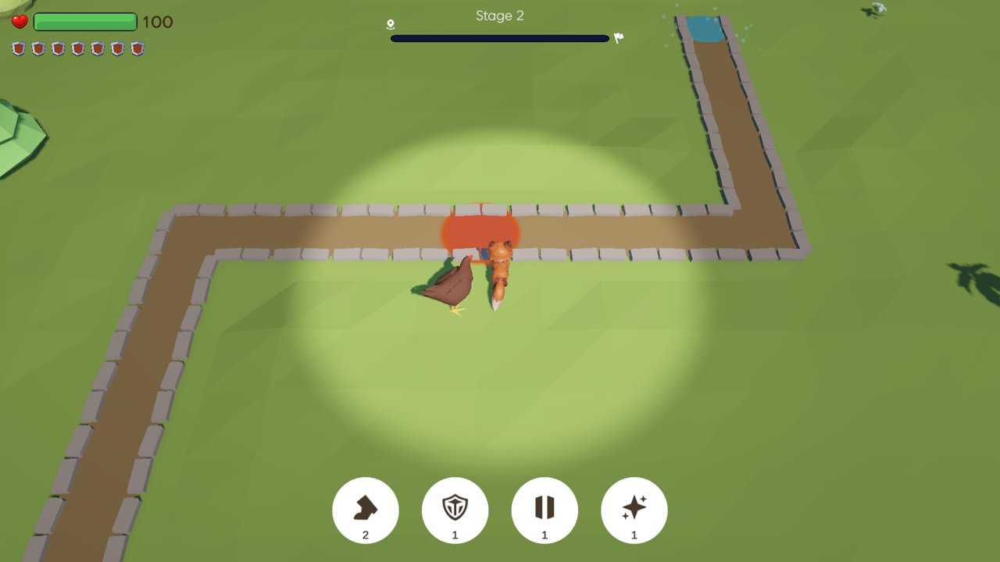
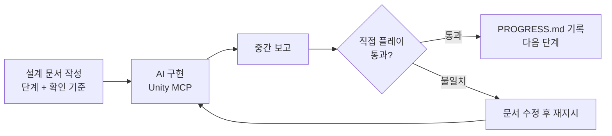

# 🦊 여우는 죄가 없다

**타워디펜스를 뒤집었습니다. 이번엔 타워가 적입니다.**

기획자 1인이 **Claude Code × Unity MCP**로 기획부터 구현·플레이테스트까지 혼자 완성한 첫 프로젝트

 

<!-- 플레이 영상이 생기면 아래 주석을 풀고 링크를 넣으세요

-->

 

## 📌 한눈에 보기

| 항목 | 내용 |
| --- | --- |
| 장르 | 리버스 타워디펜스 (탑다운) |
| 엔진 | Unity 6.3 (URP) · Cinemachine · Coplay Unity MCP |
| 기간 | 2026.09 (약 2주) |
| 인원 | 1인 (기획자) + AI 에이전트 |
| 개발 방식 | 기획 문서 작성 → Claude Code가 Unity MCP로 에디터를 직접 조작해 구현 → 단계별 검수 |
| 결과물 | 튜토리얼 포함 5스테이지 플레이 버전 · 플레이테스트 9명 / 플레이 로그 264판 |
| 형태 | 디벨로켓 게임기획 38기 「게임엔진 응용 프로그래밍」 과제 → 개인 프로젝트로 확장 |

> 코드를 직접 짜지 않는 기획자가 AI를 **구현 담당 팀원**으로 두고, 빈 Unity 프로젝트에서
> 플레이 가능한 게임과 플레이테스트 데이터까지 만들어낸 과정을 담은 레포입니다.

 

## 💡 기획 의도

> 타워디펜스에서 플레이어는 늘 **막는 쪽**입니다. 그 자리를 바꿔보면 어떨까?

여우는 정해진 길을 스스로 달립니다. 길가에는 달걀을 던지는 닭들이 진을 치고 있습니다.
플레이어가 할 수 있는 건 **제한된 화폐로 벽을 세워 공격을 막는 것**뿐입니다.

화폐는 일부러 부족하게 설계했습니다. 모든 공격을 막을 수 없기 때문에 플레이어는
*"어느 공격을 맞고 지나갈 것인가"* 를 골라야 합니다.

수업에서 배운 메커닉(이동, 자동 공격, 타겟 감지, 체력, 피격 피드백)은 스크립트를 복사하지 않고
**개념만 가져와 반대 입장에서 다시 설계**했습니다.

 

## 🔁 코어 루프

 

## 🖼️ 플레이 화면

| 닭의 공격 범위와 좁은 시야 | 스킬 튜토리얼 |
| :---: | :---: |
|  |  |
| **여러 닭의 범위가 겹치는 구간** | **스테이지 2** |
|  |  |

 

## 🧩 주요 시스템

**닭 (적 타워) 3종**

| 타입 | 역할 |
| --- | --- |
| 기본형 | 단일 대상 기본 공격 — 벽 배치를 익히는 용도 |
| 광역형 | 범위 공격 — 벽 하나로는 다 못 막게 만드는 압박 |
| 고DPS형 | 빠른 연사 — 무엇부터 막을지 판단하게 함 |

**여우 스킬 4종** (사용 횟수 제한) — 순간 가속 · 무적 · 정지 · 조명탄(시야 확보)

**함정 2종** — 주기적 낙석 · 상시 가시함정. 벽으로는 못 막고 스킬로 대응해야 하는 위협

**스테이지** — 튜토리얼 2개 + 본 스테이지 3개. 길과 몬스터만 배치하면 나머지 세팅을 AI가 채우는 **템플릿 씬**으로 제작

 

## 🎯 디자인 필러 & 검증

기획 단계에서 경험 목표 두 가지를 세우고, 각각 **확인할 수 있는 지표**로 바꿔 플레이테스트로 검증했습니다.
플레이 로그는 직접 설계한 `PlayStatsLogger`로 자동 수집하고, 체감은 설문으로 교차 확인했습니다.

| 필러 | 의도한 경험 | 확인 방법 | 결과 (9명) |
| --- | --- | --- | --- |
| **트레이드오프** | 다 막을 수 없으니 골라야 한다 | 잔여 화폐 · 잔여 체력 로그, "벽 위치를 고민했나" 설문 | 고민했다 **2/9**, 너무 빠듯했다 6명 |
| **정보 제한** | 좁은 시야가 순간 판단을 압박한다 | 닭 등장 → 벽 배치 반응 시간 로그, 타이밍 설문 | 시야가 너무 좁다 **7/9**, 어려웠다 **7/9** |

게임을 이해했다 · 재미있었다는 각각 **8/9**로 컨셉은 전달됐습니다.
하지만 선택을 만들려고 넣은 압박이 너무 세서, 플레이어가 **고르기 전에 살아남기 바빴습니다.**
의도는 맞았고 강도 조절에 실패한 것으로 해석했습니다.

 

## 📝 기획 판단 기록

<b>벽은 "발사를 취소"하는 게 아니라 "달걀을 막는다"</b>

 

처음에는 닭이 쏘기 전에 Raycast로 벽을 감지해 **발사 자체를 취소**했습니다.
그러자 플레이어 눈에는 닭이 그냥 가만히 있는 것처럼 보였고, 벽이 막아냈다는 손맛이 사라졌습니다.

→ 닭은 항상 던지고, **달걀이 벽에 물리적으로 부딪혀 막히도록** 바꿨습니다.
기술적으로 맞는 방식보다 플레이어에게 보이는 방식이 중요하다고 판단했습니다.

<b>화폐 공식: B = N필수 + α × N선택</b>

 

스테이지마다 "반드시 막아야 하는 공격"과 "막으면 좋은 공격"을 나눠 세고,
선택 공격 중 일부(α)만 막을 수 있게 화폐를 줍니다.
트레이드오프 필러를 감이 아니라 공식으로 조정하기 위한 장치입니다.

<b>튜토리얼: 먼저 겪게 하고, 그다음 설명한다</b>

 

"모든 걸 막을 수는 없다"는 규칙을 텍스트로 알려주지 않습니다.
튜토리얼에서 화폐가 모자라는 상황을 먼저 겪게 하고, 그 뒤에 짧게 설명을 붙였습니다.

 

## 🤖 AI와 함께 만든 방식

이 프로젝트의 진짜 산출물은 게임 하나가 아니라, **기획자가 AI를 팀원으로 운영하는 작업 구조**입니다.

### 역할 분담

| 나 (기획자) | Claude Code + Unity MCP |
| --- | --- |
| 컨셉 · 디자인 필러 · 경험 목표 정의 | 설계 문서를 바탕으로 C# 스크립트 작성 |
| 단계별 설계 문서 작성 (`design.md` 0~10단계) | Unity 에디터 직접 조작 (씬 · 프리팹 · 컴포넌트) |
| 단계마다 직접 플레이하며 통과 여부 판단 | 단계가 끝날 때마다 중간 보고 |
| 밸런스 공식 · 수치, 플레이테스트 설계와 해석 | 플레이 로그 수집 도구 구현 |
| 범위 결정 — 넣을 것과 뺄 것 | 템플릿 씬 기반 스테이지 세팅 |

### 작업 루프

### AI에게 맡기기 위해 만든 규칙 ([`CLAUDE.md`](CLAUDE.md))

AI가 빠르게 만드는 만큼 **잘못된 방향으로도 빠르게 간다**는 걸 초반에 겪고 규칙으로 정리했습니다.

- **설계에 없는 수치 · 규칙은 AI가 정하지 않는다** — 애매하면 멈추고 질문
- **한 번에 한 단계만** — 끝나면 보고하고 확인받은 뒤 다음으로
- **기획 문서(`docs/`)는 AI가 수정하지 않는다** — AI가 갱신할 진행 기록은 루트의 `PROGRESS.md`로 분리
- **씬 · 프리팹 파일을 텍스트로 고치지 않는다, 에셋 이름을 바꾸지 않는다** — `.meta` 참조가 깨지는 사고 방지

### 레포 안의 문서

| 문서 | 역할 |
| --- | --- |
| [`CLAUDE.md`](CLAUDE.md) | AI 작업 규칙 — 매 세션 AI가 가장 먼저 읽는 문서 |
| [`PROGRESS.md`](PROGRESS.md) | 단계별 진행 · 검증 결과 · 작업 중 결정된 사항 기록 |
| [`docs/design.md`](docs/design.md) | 게임 설계와 0~10단계 구현 순서 · 단계별 확인 기준 |
| [`docs/reference.md`](docs/reference.md) | 기능 명세 · 일부러 제외한 설계 · 과제 요건 |
| [`docs/tutorial.md`](docs/tutorial.md) | 튜토리얼 흐름과 연출 |
| [`docs/feature-expansion.md`](docs/feature-expansion.md) | 스킬 · 함정 · 특수 지형 추가 기획 |
| [`docs/stage-add-guide.md`](docs/stage-add-guide.md) | 템플릿 씬으로 스테이지를 추가하는 절차 |
| [`docs/ui-design.md`](docs/ui-design.md) · [`docs/polish.md`](docs/polish.md) | HUD · 결과 화면 설계, 폴리싱 순서 |

 

## 🔭 회고

### 잘한 점

**기획 문서가 곧 개발 지시서가 됐다.**
"재미있게 해줘"가 아니라 "닭이 보이고 1.5~3초 안에 판단하게"처럼 확인할 수 있는 문장으로 써야
AI가 의도대로 만든다는 걸 배웠습니다. 기획서를 쓰는 방식 자체가 달라졌습니다.

**감이 아니라 데이터로 판단했다.**
화폐 공식과 측정 지표를 먼저 정해두고, 로그 수집 도구를 만들어 실제 플레이테스트로 확인했습니다.
만든 사람은 답을 알고 플레이하니 못 느끼는 문제를, 테스트를 받아보고서야 알 수 있었습니다.

**마감 앞에서 범위를 잘랐다.**
스킬 · 함정까지 구현하고, 빙결 지대 같은 특수 지형은 확장할 수 있는 구조만 남긴 채 보류했습니다.

### 아쉬운 점

**문서와 실제 구현이 어긋났다.**
벽 차단 방식을 Raycast에서 물리 충돌로 바꿨는데, `PROGRESS.md`의 확인 기준은 예전 방식 그대로였습니다.
AI는 문서를 기준으로 일하기 때문에, **설계가 바뀌면 코드보다 문서를 먼저** 고쳐야 한다는 걸 알게 됐습니다.

**문제의 원인을 AI 탓으로 돌릴 뻔했다.**
프리팹 구조가 초기화됐을 때 처음엔 MCP 오류를 의심했지만, 원인은 제가 모델 파일을 수동으로 다시 불러온 것이었습니다.
AI와 함께 작업할 때는 **내가 직접 한 조작까지 기록해야** 원인을 빨리 찾을 수 있습니다.

**재미를 늦게 의심했다.**
기본 구현을 끝낸 뒤에야 단조롭다고 느껴 스킬과 함정을 추가했습니다.
다음에는 코어 루프만 있는 단계에서 먼저 플레이해보고 방향을 정하려 합니다.

### 다음 단계

- 시야 반경 · 화폐 압박을 완화하고 같은 지표로 재테스트
- 초반 스테이지에 여유를 줘서 난이도 곡선 다시 잡기
- 보류한 빙결 지대 등 특수 지형 확장

<!-- 노션 회고 페이지를 공개했다면 아래 주석을 풀고 링크를 넣으세요
📓 전체 회고: [노션 기획 일지](https://노션주소)
-->

 

김진용 · Game Designer

